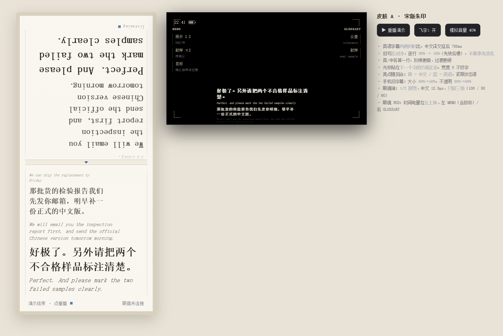

# 旅行同传 · 面对面字幕界面原型 · 14 套视觉方案

> **这是浏览器里的交互与视觉原型。** 使用**预设的六句对话**和**模拟状态**，**没有接入**真实麦克风采集、语种识别、流式 ASR、机器翻译或 AR 硬件；中间的"AR 眼镜视野"是页面里画的 mockup，不是真机投屏。它要回答的问题是"一个屏幕两端坐两个人的同传界面该长什么样"，不是"同传系统能不能跑"。
>
> 14 个单文件 HTML。运行时无外部网络请求、无需构建步骤；两套皮肤内嵌了第三方像素字体（见 §8），其余使用系统字体栈。
>
> *Fourteen visual systems for a face-to-face interpretation UI on phone + AR-glasses mockup. Browser prototype only: preset text, simulated states, no audio capture, no ASR, no translation service, no AR hardware.*



---

## 0. 已实现 / 模拟 / 未接入

| | |
|---|---|
| **已实现** | 14 套独立皮肤，每套是可操作的原型；双端布局（手机上下两屏 + 眼镜视野）；180° 旋转的对方侧；逐字流式出字；历史行逐行缩放与衰减；飞字动效；规格面板实时显示当前皮肤参数；总览页（`index.html`，缩略图内嵌）；两个自查脚本 |
| **模拟** | 对话内容（固定六句，中英交替）；"模拟音量 40%"按钮（就是一个布尔状态，不读取任何音量）；"模拟丢包"（切换状态行文案，没有真实网络链路）；眼镜端连接状态 |
| **未接入** | 麦克风采集、VAD、语种识别、ASR、机器翻译、设备间通信、AR 眼镜真机渲染、任何后端 |
| **未验证** | 眼镜端在真实光机上的可读性（本仓库只有浏览器 mockup）；`558px` 半屏参数的光学依据；真实翻译延迟 |

---

## 1. 为什么不是"随便做十几个配色"

面对面同传和普通字幕最大的区别：**屏幕两端坐着两个人**。这件事决定了界面里每一个尺寸。

| 场景约束 | 界面上的后果 | 这个数是算的还是定的 |
|---|---|---|
| 手机平放桌上，对面的人也在看同一块屏 | 对方那半边整体旋转 180°，包括状态行和字幕块 | 定 |
| 对方看不懂中文 | 对方那半边不出现中文，只有英文 | 定 |
| 眼镜端只做半屏宽度 | 眼镜块宽 279px（按外部给的 558 宽取半） | 算，但 558 的来源未核实 |
| 中文 17px 的四分之三用于眼镜 | 12.75px，参数取 **12.8px** | 算 + 取整 |
| 英文按 0.62 缩小 | 12.8 × 0.62 = 7.936，参数取 **8px** | 算 + 取整 |
| 翻译必然有延迟 | 原话先出，译文晚 700ms 开始逐字流；中文 55ms/字，英文 20ms/字 | 定（动画参数，不是性能测量） |
| 一句话说完不能立刻消失 | 旧行按**视觉行**指数衰减（§4.1 有精确表） | 定 |
| 眼镜是光机投射，细小字号发虚 | 眼镜端只留当前句 + 2 句历史，100% / 80% / 60%；手机端留到第 3 行以后 | 定 |
| 需要判断"谁在说" | 按语言近似路由，见下方的限制 | 定 |

**关于 558 和 12.8：** `558px` 是外部提供的参数，本仓库没有设备型号、视场角、渲染缩放或"取半屏"的依据，也**没有做过光学可读性验证**。279 这个除法成立，但"12.8px 在眼镜上能读清"这件事没有被证明过 —— 浏览器里的 px 与光机投射后的角分辨率不是一回事。

### 1.1 按语言路由，不是说话人识别

原本的设计写的是"听到中文 = 我方在说；听到英文 = 一律按对方说处理"，并称这样"单麦就能跑"。**这句话夸大了。** 语种判定不等于说话人判定：

| 谁在说 | 说什么语言 | 判定结果 | 手机我方屏 | 手机对方屏 | 眼镜 |
|---|---|---|---|---|---|
| 我 | 中文 | 正确 → 我方 | 中文原文 + 英译 | 英译 | 英译 |
| 对方 | 英文 | 正确 → 对方 | 中译 | 英文原文 + 中译？ | 中译 |
| **我** | **英文** | **误判 → 对方** | 中译（把自己说的话翻回中文） | 英文原文 | 中译 |
| **对方** | **中文** | **误判 → 我方** | 中文原文 | 英译 | 英译 |
| 两人同时说 | 任意 | 无路由规则 | — | — | — |

所以准确说法是：**在"我说中文 / 对方说英文"这个预设角色—语言对应下，用语种近似决定字幕路由；不做说话人识别，误路由场景如上表。** 中英混说和重叠发言没有处理方案。

至于"我说英语也能兜住"：它只意味着英文原文仍然会显示出来，不意味着说话人归属、翻译方向和眼镜端内容都正确。

---

## 2. 跑起来

双击 `index.html` 看总览，或直接打开任意 `skins/*.html`。没有网络请求、没有构建步骤。

```
index.html              14 套方案总览（缩略图内嵌，494 KiB）
skins/A-songti.html     单套原型，665~755 行，自包含
skins/K-ticket45.html
shots/*.png             各方案三端同框展示图，1372~1400 × 892~938
docs/gallery.md         14 套图库与逐套说明
_skipped/README.md      淘汰方案（E）的判定记录
LICENSE                 MIT（本仓库原创部分）
LICENSE-OFL-1.1.txt     第三方像素字体的 SIL OFL 1.1 全文
THIRD-PARTY.md          第三方资产清单
tools/probe_layout.py   14 页排版体检：水平溢出 / 行间真交叠 / 碎片行
tools/shoot_shots.py    14 张展示图重出：起服务 → 逐页截图 → 裁页边空白
```

两个脚本需要本机 Edge：

```bash
python -m http.server 8137        # 仓库根目录起服务（probe_layout.py 需要）
python tools/probe_layout.py      # 输出每页行数、交叠数、溢出元素
python tools/shoot_shots.py       # 重出 shots/ 下 14 张图，自带服务不用另起
```

---

## 3. 14 套方案

同一份内容、同一套动效，只换底色、字族、分界线画法和装饰。图库在 **[`docs/gallery.md`](docs/gallery.md)**（14 张图）。

| # | 方案 | 分界线的画法 | 主导视觉母题 |
|---|---|---|---|
| A | 宋版 · 朱印 | 中缝窄空带 + 鱼尾三角 | 纸本双色、版心线 |
| B1 | 像素屏 · 深底 | 3×3 点阵点 | 12px 点阵字体 |
| B2 | 像素屏 · 白底 | 3×3 点阵点（绿） | 同上，白底绿字 |
| B3 | 白底青字 · 非像素 | 青绿点划线 | 抽掉点阵、换常规字族 |
| B4 | B3 + 四角括号 | 点划线 + 四角 HUD 框 | LINK / TRK 读数 |
| B5 | B3 + 飞字 | 字符边飞边转 180° | 传递感 |
| C | 瑞士国际主义 | 刻度短桩 | 1.25 以上字阶、严格栅格 |
| D | 终端 · TUI | 1px 虚线 + 两端竖线 | 全暗色、等宽 |
| F | 票根 | 撕票线 + 半圆打孔 | 打孔露出桌面色 |
| G | 字幕台 | hairline + 胶片齿孔 | 历史句被画框边缘切半 |
| H | 导视牌 | 海军蓝带 + 黄箭头 | 黄色只作方向强调 |
| I | 拼贴剪贴 | 纸缝 + 斜贴胶带 | 牛皮纸桌面 + 白纸面板 |
| J | Aicher 奥林匹克 | 六色段细带 | 参考 Aicher 配色逻辑，不用红与金 |
| K | 票根 · 45° | 虚线 + 45° 三角切口 | 只允许 45°/90° |

编号里没有 E。第一批的 E（构成主义 · 斜轴）被放弃：斜轴 −5° 会划过对方那栏最后一行字，红块压住深色正文按 WCAG 公式算约 2.1:1。判定过程在 `_skipped/README.md`。

---

## 4. 两项核心实现

### 4.1 历史行缩放：保住原有断行

历史行要逐行变小。直觉做法是改 `font-size`，但一改字号**断行位置就变** —— 同一句话在 75% 时可能折到不同的地方，中文尤其明显。需求写死了"原来在哪里换行的要保持不变"。

**本原型的做法**是 `transform: scale()`：布局宽度不动，断行不变；再用负 margin 把缩掉的高度还给布局。这不是唯一解（也可以预先测量断行点后固定 `<br>`，或用一个不参与布局的克隆层承担视觉），只是这里选了最省事的一条。

```js
function ladderScale(i, cur){
  const j = i - cur;                          // j=0 → 第一条历史行
  if (j < 0) return 1;                        // 当前句（cur 已扣掉当前句占的行数）
  return 0.50 + 0.30 * Math.exp(-0.45 * j);
}
function applyScale(el, k, o){
  el.style.transform = `scale(${k})`;
  el.style.opacity = String(o);
  const h = el.offsetHeight;
  const d = (k > 0.999) ? 0 : (-h * (1 - k) / 2 + 1.5);   // +1.5 → 相邻两行之间留 3px 呼吸
  el.style.marginTop = d + "px";
  el.style.marginBottom = d + "px";
}
```

索引含义（这一条容易读错，所以列全）：`cur = mine ? 2 : 1` —— 我方当前句占 2 行（中文 + 英文），对方占 1 行（只有英文）。所以 `j = 0` 是**第一条历史行**，不是当前句。

| 位置 | 尺寸 `scale` | 不透明度（我方 / 对方） |
|---|---|---|
| 当前句 | 1.00 | 1.00 / 1.00 |
| 第 1 条历史 | **0.80** | 0.90 / 0.80 |
| 第 2 条历史 | 0.691 | 0.83 / 0.70 |
| 收敛值（j→∞） | **0.50** | **0.60 / 0.50** |

注意收敛值不对称：中文本栏收敛到 60%，英文侧收敛到 50%。旧版 README 笼统写"手机端衰减到 50%"，对中文侧不成立。

眼镜端是三点线，不是指数：当前句 100/100 → 上一句 80/80 → 再上一句 60/60，第四组直接 `remove()`。只有三组时指数曲线到不了 60%，所以改用线性三点。

`transform-origin` 落在起始侧（我方 `left`、对方 `right`，因为对方整块倒了 180°）。这一条是本原型的对齐需要，不是普遍规则 —— 换成别的对齐方式，锚点也就该换。

负 margin 的方案有前提：本原型的历史行是块级、行高固定、没有边距折叠参与的普通流布局。换布局模型（flex 子项、grid、或带 `overflow` 的容器）这个写法不能无条件照搬。

### 4.2 飞字对齐：起终点每帧重算

字母从一栏飞到另一栏，用 `getBoundingClientRect()` 取起终点。第一版落地偏差 10px 左右，越往后越离谱。量出两个根因：

1. **固定偏 `dx=10, dy=10`** — 手机外壳是 `border:10px`。绝对定位子元素以 **padding box** 为原点，而 `getBoundingClientRect()` 以 **border box** 为原点，两者差一个边框宽度
2. **`dy` 会出现 26.7 / 43.7 / 66.4 这种量级** — 飞行那 420ms 里句子还在打字，**换行、整行上移**都在发生。端点只在起飞时算了一次，落地时目标早就挪了

修法：起点、终点、边框补偿全部挪进 rAF 每帧重算，盒子尺寸和 `line-height` 也每帧照抄目标字符。

**rAF 与 WAAPI 的分工**（旧版没写清）：WAAPI 只管每个字符自己的 `transform: rotate() scale()` 与 `opacity`，是一段建好就不动的三段关键帧（起点 → 55% 抬高 16px 形成弧线 → 终点）；**外层 span 的 `translate(x, y)` 由 rAF 每帧写**。两者作用在不同元素上，不抢同一属性，所以不存在"改了坐标但关键帧不跟着变"的问题。

```js
f.style.opacity = ".7";     // 飞行途中不透明度 0.7（= 透明度 30%），落点做 420ms 过渡
```

飞字用 `display:inline` 而不是 `inline-block`，否则英文会在任意字母处断行。

**关于"最大偏差 0.01px / 22 次飞行 / 超过 0.6px 的 0 次"：这三个数字已从本文撤下。** 原因：测量脚本没有入仓；没记录浏览器版本、DPR、缩放、比的是什么（DOM 盒子？字形可见边界？截图像素？）；而且目标位置与动画终点若来自同一套计算，测出来只是自洽性，不是落点精度。现在只能说：改完之后肉眼看不出偏移，DOM 盒子层面的偏差在亚像素级 —— 但没有可复现的测量。

### 4.3 一次自查：像素字体的 `!important` 泄漏

**现象。** B1/B2 的右侧说明面板，放大 3 倍后"两侧同时"糊成一个白块。

**做法是量，不是看。** 页面里塞探针，把结果写进 `document.title`，用无头浏览器 `--dump-dom` 取回来：

```js
getComputedStyle(hint).fontFamily          // → FusionPixel, "Courier New", ...
getComputedStyle(hint).fontSize            // → 11.5px
document.createRange().getClientRects()    // → 逐行 top/bottom/left/right
```

两个数据定性：

- **字族是 `FusionPixel`。** 全局有一条 `.devbar{font-family:var(--sf)!important}`，把说明面板也切成了 12px 点阵字体，而面板字号是 11.5 / 12 / 14 三档
- **逐行坐标里没有几何重叠。** 第一版探针报了 20 处"重叠"，全是父元素 rect 与自己的子文本 rect 被重复计数（父子必然包含）。剔掉容器 rect、只比纯文本 rect，**真重叠 0 处**

**修法。** 从那条选择器里删掉 `.devbar`。依据是 CSS 里本来就写着的注释：`/* 演示控制条（不属于界面） */`。

需要说清的边界：**DOM 矩形不重叠只能排除几何重叠这一类原因**，排除不了阴影、伪元素、滤镜、覆盖层、字形外伸。所以准确结论是"**定位到字体渲染差异**"（字族被 `!important` 改掉 + 字号不在点阵字体的整数倍上），不是"已证明只可能是糊"。严格的做法应做同尺寸同环境、仅换字体的前后对照截图 —— 当时没做，这里作为待补项。

**顺带修掉碎片行。** 这里有两个不同指标，旧版把它们混成一个：

- **语义碎片行**（人看出来的）：像「淡化」「→60%」「/ 80 / 60）」这种被折断的短语。面板宽 268px 时存在
- **窄行**（脚本 `frag` 的口径）：宽度 < 40px 的行。268px 时统计为 **0**

所以旧版"268px 有 12 行、frag=0"并不矛盾，是两个指标。扫宽度定到 330px，此时语义碎片行消失、窄行仍为 0、行数从 12 降到 9：

| 面板宽 | 行数 | 窄行（< 40px） |
|---|---|---|
| 268px | 12 | 0（但有语义碎片行） |
| 290–312px | 11 | 2 |
| 320px | 10 | 1 |
| **330px** | **9** | **0** |
| 340–356px | 9 | 0 |

330 之后不再有收益，就定 330。同时核对 14 个文件在该宽度下 `.phone` / `.glasses` / `.devbar` 的 `top` 全等于 34px —— 只能说"当时这三个盒子没有换行"，不是布局无问题的证明。

---

## 5. 验证入口，以及它测不到什么

`tools/probe_layout.py` 对 14 个页面跑三项**自定义**判据：

| 判据 | 口径 | 已知盲区 |
|---|---|---|
| 水平溢出 | 元素 `scrollWidth` 超出父容器 | **主动排除 `overflow: hidden/auto/scroll` 的元素** —— 而内容裁切恰好发生在这些元素里 |
| 行间真交叠 | 纯文本 rect 两两相交，剔掉父子包含 | 只比对文本节点，不覆盖绝对定位层、伪元素、覆盖层 |
| 碎片行 | 宽度 < 40px 的行 | 测不出语义碎片行（§4.3 的「淡化」这类） |

当前结果：**在本次测试环境下，14 个页面的三项判据均未触发（0 / 14）**。

这个结果能支持的结论只有一句：*在指定浏览器、指定视口、指定样例文本、动画终态下，这三项自定义检查没有报警。* 不能支持"页面没有问题"。要更强的结论需要：标注视口与 DPR、覆盖播放过程中的多个时点、把 `overflow:hidden` 的裁切单独建判据、加上对比度与遮挡时长的检查。

**关于调试心得。** 旧版写"新判据第一次跑就一堆 FAIL，八成是判据错了"。这个比例没有依据，而且导向是错的：大面积失败既可能是判据误报，也可能是共享 CSS 或公共逻辑里的真缺陷。正确做法是先抽样复核失败项，分类成"检测器误报"与"真实缺陷"；改判据时必须保留反例与回归用例，否则改判据就成了消除失败。

---

## 6. 已知限制

**对比度不达标（实测）。** 按 WCAG 相对亮度公式在纯白底、完全不透明下实算：

| 前景 | 对比度 | WCAG 普通正文门槛 4.5:1 |
|---|---|---|
| `#45B787`（B2/B3 主字） | **2.51 : 1** | 不达标 |
| `#2E8A63`（副行/元信息） | **4.26 : 1** | **仍不达标** |

旧版写"压深到 `#2E8A63` —— 否则整屏都读不清"，这句话容易被读成"已经解决"。**没有解决。** 要达到 4.5:1 需要 `#1F6B4A`（6.44:1）这一档，会显著改变 B2/B3 的观感，所以没改。当前状态是：主字比副行淡，副行也没过门槛。历史行还会再乘 `opacity`，合成后的实际对比度更低，需按合成色重算。这是一套**不合规的实验方案**，不是达标的可访问性实现。

**像素字体只在特定条件下稳定。** B 系列用 Fusion Pixel 12px，本原型在 Edge、DPR 1 下用 12 / 24px 截图稳定。这不是"像素字体只能用 12 的整数倍"的普遍定律 —— 清晰度还受 DPR、浏览器缩放、坐标对齐、抗锯齿影响。而且历史行的 `transform: scale()` 会产生小数坐标，与像素对齐天然冲突；本原型对 B1/B2 的历史行接受了这一点，没有做整数化处理。

**"模拟丢包"是一个文案开关。** 按钮切换的是状态行文字，没有真实网络链路，也没有重传、乱序、字幕缺失的任何处理逻辑。

**飞字会瞬时遮挡正文。** 字符横穿过去时确实压在其他文字上方。这不是布局塌陷（DOM 尺寸量过是完全正确的），但**是实打实的可读性影响**，不是"假 bug"。遮挡时长约 420ms；没有做避让路径，也没有提供"减少动态效果"开关（`prefers-reduced-motion` 未处理）。

**14 份皮肤是手工复制的，没有生成器。** CSS 参数收敛在自定义属性里，但 HTML 结构与 JS 行为是逐份复制的，没有一致性检查脚本。当前版本逻辑是一致的（改一处会手工同步 14 处）；以后修 bug 时存在分叉风险。

**图标与截图是终态。** `shots/*.png` 用注入脚本把动画推到终态后截取，刻意避开了出字中途、飞字横穿、历史行缩放的时段。它们只能展示静态版式，不能作为动效证据。

---

## 7. 四条自用判据

不是"我觉得好看"，是四条能在评审时被追问的约束：

1. **一套方案有一个主导视觉母题** —— 票根的撕票线 + 半圆打孔、字幕台的历史句被画框切半、导视牌的黄箭头色带。不是"有且只有一个元素"（撕票线和打孔本来就是两样东西），而是"主视觉只有一个来源"
2. **限制状态色数量，并写明每种颜色的语义** —— 票根的朱红只给"正在说"、墨绿只给"已送达"；导视牌的黄只作方向强调。这是"少而固定"，不是"只有一个"（朱红 + 墨绿本身就是两个）
3. **每套挂一个真实物体的物理约束** —— 票根受"打孔 + 一次性"约束；字幕台受"投影在画面上、边缘即画框"约束；导视牌受"远距离可读、只用正交角度"约束。约束越硬，越不像套模板
4. **正文层字阶比率不小于 1.25** —— **这条只适用于产品皮肤正文层**（`.phone` / `.glasses` 内的字级）。说明面板是元信息层，用 11.5 / 12 / 14 三档，相邻比率小于 1.25，不在此规则范围内。各皮肤的实际字阶没有逐层核过，所以这里不写"所有层级都不允许差不多大"

H 的"黄不进正文"、K 的"只允许 45°/90°"都是**本方案自己定的约束**，不是机场导视或任何设计门类的通行规矩。

---

## 8. 许可

界面设计、CSS 与 JS 为原创，**MIT**（见 `LICENSE`）。

唯一第三方资产：**Fusion Pixel 12px Monospaced**（`zh_hans` 子集，TakWolf，**SIL OFL 1.1**），以 base64 WOFF2 内嵌在 `skins/B-pixel.html` 与 `skins/B-paper.html` 的 `@font-face` 中，未作修改。两个文件的 `@font-face` 上方保留了署名注释。

OFL 1.1 要求随字体分发时附带许可证副本，因此：

- 许可全文随仓库分发：**[`LICENSE-OFL-1.1.txt`](LICENSE-OFL-1.1.txt)**（正文逐字来自 openfontlicense.org，未改）
- 上游版权行与 Reserved Font Name 以上游仓库为准：<https://github.com/TakWolf/fusion-pixel-font>
- 资产清单与范围说明：**[`THIRD-PARTY.md`](THIRD-PARTY.md)**

**字体部分不受 MIT 覆盖。** "运行时无网络请求"与"不含第三方资产"是两件事 —— 前一句成立（字体是内嵌的），后一句不成立（字体是第三方资产）。
