# 旅行同传 · 双端字幕界面 14 套视觉方案

> 出国旅行用的**面对面同声传译**界面原型：一部手机放在桌上，一副 AR 眼镜戴在我脸上，两个方向的人同时看字幕。
> 14 个单文件 HTML，零依赖、零构建、双击即开。
>
> *Fourteen visual systems for a face-to-face interpretation UI on phone + AR glasses. One DOM tree, one motion model, fourteen visual languages. Every skin is a single dependency-free HTML file.*

---

## 一、为什么不是"随便做十几个配色"

面对面同传和普通字幕最大的区别：**屏幕两端坐着两个人**。这件事决定了界面里每一个数字。

| 场景约束 | 界面上的后果 |
|---|---|
| 手机放桌上，对面的人也在看同一块屏 | **对方那半边整体旋转 180°**，包括状态行和字幕块。两人看到的方向都是正的 |
| 对方是外国人，看不懂中文 | 对方那半边**禁止出现中文**，只有英文 |
| 眼镜端只有半屏可用（558px 屏取 1/2） | 眼镜块宽锁死 **279px**，中文 **12.8px**（=17×0.75），英文 **8px**（=12.8×0.62）；块左右居中、文字左对齐 |
| 翻译一定有延迟 | 原话先出，译文晚 **700ms** 开始逐字流；中文 55ms/字，英文 20ms/字 |
| 一句话说完不能立刻消失 | 旧句按**行**指数衰减：当前句 100%，往外第 1 行 80%，收敛到 50%，先快后慢 |
| 用户听不出"对方没听见" | 系统音量 < 50% 时，底部状态行变红报警 |
| 眼镜是光机投射，细小字号会糊 | 眼镜端只保留"当前句 + 2 句历史"，尺寸 80%→60%；手机端可以留 6 行、衰减到 50% |
| 音源方向需要判断谁在说 | **不按声源，按语言**：听到中文 = 我方在说；听到英文 = 一律按对方说处理。这样我说英语也能兜住，对方看到的是我的英文原文，不会因为口音听不懂 |

最后一条是这套设计里最反直觉的决定。直觉方案是双麦克风分人（眼镜麦贴嘴=我，手机麦收对面=对方），但眼镜麦当时还没验证。改成按语言判定后，单麦就能跑，而且顺带解决了"我说英语"的场景。

---

## 二、页面上能做什么

每个皮肤页都是**可直接操作的原型**，不是截图片：

- **重播演示** — 走一轮完整的 6 句对话（中英交替）
- **飞字：开 / 关** — 字母从对面那侧起飞、边飞边转 180°、途中 70% 透明，落到目标行。关掉就回落成零宽光标逐字出
- **模拟包层 40%** — 模拟网络丢包，看状态行怎么反应
- 右侧常驻**规格说明面板** — 当前皮肤的尺寸、透明度、延迟全部写在页面上，改完代码能立刻对照

所以面试时不用讲，打开就是成品。

---

## 三、14 套方案

同一份内容（一批货的验货对话）、同一套动效，只换底色、字族、分界线画法和装饰。

| # | 方案 | 分界线的画法 | 签名元素 | 预览 |
|---|---|---|---|---|
| A | 宋版 · 朱印 | 中缝窄空带 + 鱼尾三角 | 纸本双色、版心线 | 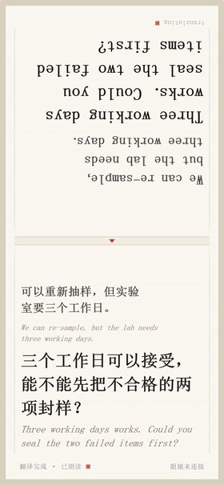 |
| B1 | 像素屏 · 深底 | 3×3 点阵点 | 12px 点阵字体 | 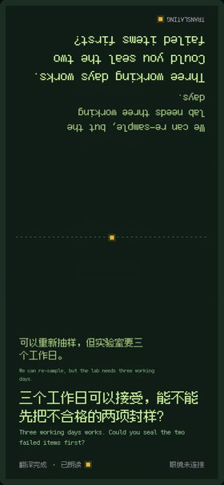 |
| B2 | 像素屏 · 白底 | 3×3 点阵点（绿） | 同上，白底绿字 | 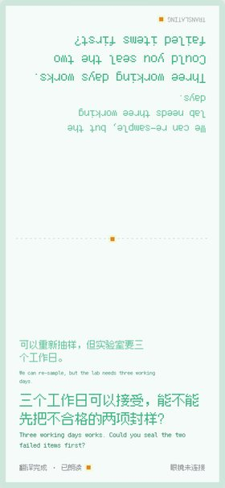 |
| B3 | 白底青字 · 非像素 | 青绿点划线 | 抽掉点阵、换常规字族 |  |
| B4 | B3 + 四角括号 | 点划线 + 四角 HUD 框 | LINK / TRK 读数 | 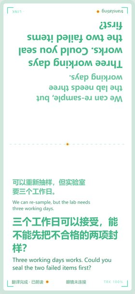 |
| B5 | B3 + 飞字 | 字符边飞边转 180° | 传递感 | 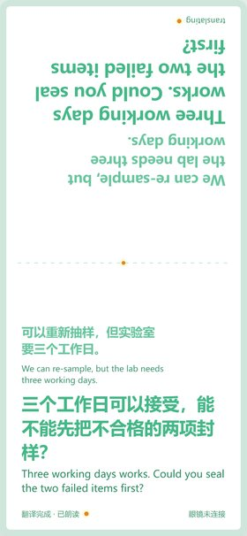 |
| C | 瑞士国际主义 | 刻度短桩 | 1.25 以上字阶、严格栅格 | 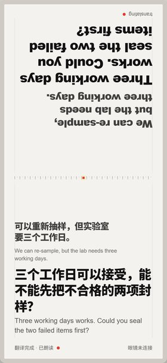 |
| D | 终端 · TUI | 1px 虚线 + 两端竖线 | 全暗色、等宽 | 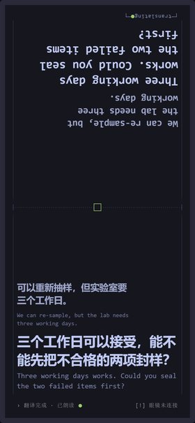 |
| F | 票根 | 撕票线 + 半圆打孔 | 打孔露出桌面色 | 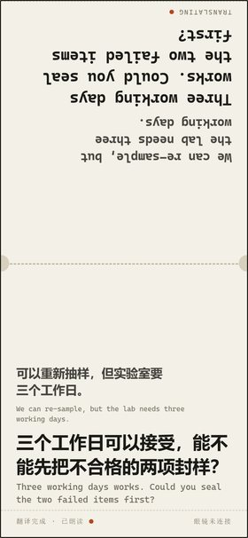 |
| G | 字幕台 | hairline + 胶片齿孔 | 历史句被画框边缘切半 | 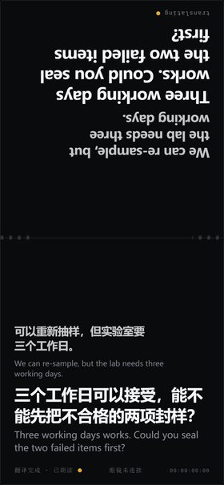 |
| H | 导视牌 | 海军蓝带 + 黄箭头 | 黄只用于指向，永不进正文 | 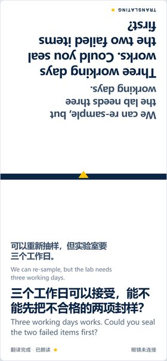 |
| I | 拼贴剪贴 | 纸缝 + 斜贴胶带 | 牛皮纸桌面 + 白纸面板 | 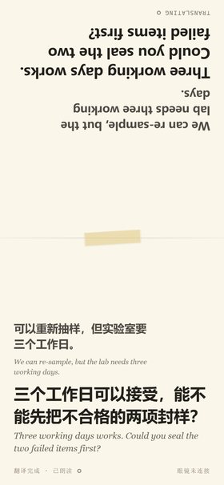 |
| J | Aicher 奥林匹克 | 六色段细带 | 刻意不用红与金 | 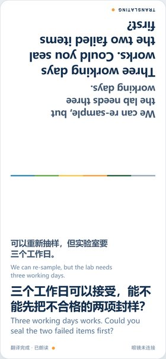 |
| K | 票根 · 45° | 虚线 + 45° 三角切口 | 只允许 45°/90° | 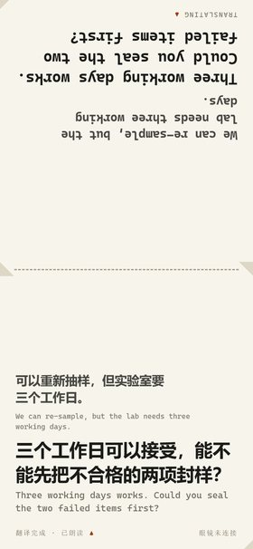 |

`index.html` 是带缩略图的总览页，离线可看。

---

## 四、判断这套设计好不好，有四条自己的判据

不是"我觉得好看"，是四条能复用的规则。这三套旧稿（票根 / 字幕台 / 导视牌）之所以立得住，就是因为都满足：

1. **每套有且只有一个签名元素** — 票根的撕票线加两侧半圆打孔；字幕台的历史句被画框边缘切掉一半；导视牌的指向对方的箭头色带
2. **每套只有一个信号色，而且只给"当前"** — 票根朱红只给"正在说"，墨绿只给"已送达"；导视牌黄永不用于正文
3. **每套有一个真实物体的物理约束** — 票根受"打孔 + 一次性"约束；字幕台受"投影在画面上、边缘即画框"约束；导视牌受"远距离可读、只准 45°/90°"约束。约束越硬，越不像套模板
4. **字阶比率不小于 1.25** — 不允许出现"差不多大"的两级

后面的 B3/B4/B5、I/J/K 也是照这四条出的。

---

## 五、四个值得单独讲的实现细节

### 5.1 缩放只能 `transform: scale()`，不能改字号

历史行要逐行变小。直觉做法是改 `font-size`，但一改字号**断行位置就变** —— 同一句话在 75% 时可能折到不同的地方，中文尤其明显。而需求写死了"原来在哪里换行的要保持不变"。

这里的做法是 `transform: scale()`，布局宽度不动，断行完全不变；再用负 margin 把缩掉的高度还给布局，历史行才能紧凑地堆到分界线前。

```js
function ladderScale(i, cur){
  const j = i - cur;                            // 往外数第几行
  if (j < 0) return 1;
  return 0.50 + 0.30 * Math.exp(-0.45 * j);     // 80% 起步 → 收敛 50%，先快后慢
}
function applyScale(el, k, o){
  el.style.transform = `scale(${k})`;
  el.style.opacity = String(o);
  const h = el.offsetHeight;
  const d = (k > 0.999) ? 0 : (-h * (1 - k) / 2 + 1.5);   // +1.5 → 相邻两行之间留 3px 呼吸
  el.style.marginTop = d + "px";
  el.style.marginBottom = d + "px";
}
```

缩放锚点也有讲究：`transform-origin` 必须落在**起始侧**（我方 left / 对方 right，因为对方整块倒了 180°），否则缩小时文字会往中间跑，历史行看起来像在漂。

### 5.2 光标是零宽的

流式出字要跟一个光标。如果光标有宽度，它一出现就会挤动后面的字，整行重新折行，版面开始抖。

所以光标做成 `width:0` 的 inline-block，竖线画在 `left:0` —— 宽度 0 意味着它**完全不参与排版**：不挤字、不改折行、不会一跳一行。

对方那侧还有一层：整块已经转了 180°，偏移量如果不翻，2px 就会甩到"背着字"的另一边，跟"光标贴着已有字"正好相反。所以对方侧单独写 `.pane-other .caret::before{ left:auto; right:0 }`。

> 教训：任何挂在翻转容器里的视觉偏移，都要自己先翻一次再写。

### 5.3 飞字的"出发准、到达偏"，两个根因都是量出来的

字母从一栏飞到另一栏，用 `getBoundingClientRect()` 取起终点。第一版落地时偏差 10px 左右，越往后越离谱。

量了两个根因，都不是猜的：

1. **固定偏 `dx=10, dy=10`** — 手机外壳是 `border:10px`。绝对定位子元素以 **padding box** 为原点，而 `getBoundingClientRect()` 以 **border box** 为原点，两者差一个边框宽度
2. **`dy` 会出现 26.7 / 43.7 / 66.4 这种量级** — 飞行那 420ms 里句子还在打字，**换行、整行上移**都在发生。端点只在起飞时算了一次，落地时目标早就挪了

修法：起点、终点、边框补偿**全部挪进 rAF 每帧重算**，盒子尺寸和 `line-height` 也每帧照抄目标字符。改完复测 22 次飞行，最大偏差 0.01px，超过 0.6px 的 0 次。

飞字本身用 WAAPI 三段关键帧：起点（源字号、`rotate(180deg)`、70% 透明）→ 55% 中点（抬高 16px 形成弧线、`rotate(90deg)`）→ 终点（目标字号、`rotate(0)`）。每字一个 `<span class="ch">`，用 `display:inline` 而不是 `inline-block`，否则英文会在任意字母处断行。

### 5.4 一次自查：像素字体的 `!important` 泄漏到了说明面板

这是我自己埋的坑，也是这套东西里唯一一处"知道规则却违反了规则"。

**现象。** B1/B2 两套的右侧说明面板，放大 3 倍后"两侧同时"四个字糊成一个白块，看起来像两行文字叠在一起。

**不能靠看，要量。** 页面里塞一段探针，把结果写进 `document.title`，再用无头浏览器 `--dump-dom` 取回来：

```js
getComputedStyle(hint).fontFamily          // → FusionPixel, "Courier New", ...
getComputedStyle(hint).fontSize            // → 11.5px   ← 点阵字体的死穴
document.createRange().getClientRects()    // → 逐行 top/bottom/left/right
```

两个数据一出来就定性了：

- **字族是 `FusionPixel`**。全局有一条 `.devbar{font-family:var(--sf)!important}`，把说明面板也切成了 12px 点阵字体。而面板字号是 11.5 / 12 / 14 三档 —— **只有 12 是点阵的整数倍**，11.5 和 14 一定被重采样糊掉。白块不是重叠，是糊。
- **逐行坐标证明没有重叠**。第一版探针报了 20 处"重叠"，但它们全是父元素 rect 与自己的子文本 rect 被重复计数（父子必然包含）。把容器 rect 剔掉、只比纯文本 rect，**真重叠 0 处**。

**修法。** 从那条选择器里删掉 `.devbar`。依据不是审美，是 CSS 里本来就写着的那行注释：`/* 演示控制条（不属于界面） */` —— 产品皮肤只有 phone 和 glasses 两个 mockup，说明面板是元信息层，不该穿产品字体。

**顺带修掉碎片行。** 面板宽 268px 时说明文案折成 12 行，中间夹着「淡化」「→60%」「/ 80 / 60）」这种碎片行。不拍脑袋，直接扫宽度：

| 面板宽 | 行数 | 窄行（< 40px） | 触发 flex 换行 |
|---|---|---|---|
| 268px | 12 | 0 | 否 |
| 290–312px | 11 | 2 | 否 |
| 320px | 10 | 1 | 否 |
| **330px** | **9** | **0** | **否** |
| 340–356px | 9 | 0 | 否 |

330px 之后不再有收益，就定 330。同时验证了 14 个文件在该宽度下 `.phone` / `.glasses` / `.devbar` 的 `top` 全等于 34px —— 没有一套被挤到第二行。

**留了个体检脚本。** `tools/probe_layout.py` 对 14 个页面跑三条可执行判据：水平溢出（排除 `overflow:hidden` 与已知伪元素外伸）、行间真交叠、碎片行。当前结果 **0 / 14**。

> 教训：新判据第一次跑就一堆 FAIL，八成是判据错了，不是页面错了。先分清"真问题"和"判据写错"，再动手改代码 —— 否则会把好的改坏。

---

## 六、两处如实写下的取舍

**像素字体只能用 12 的整数倍字号。** B 系列用的 Fusion Pixel 12px 是点阵字体，非整数倍会被重采样糊掉。所以那两套的字号是 24px / 12px 两档，不能像其他套那样微调到 26 或 28。这是字体带来的硬约束，不是没调。

**#45B787 在白底上的对比度只有约 2.4:1**（WCAG 正文要求 4.5:1）。B2 按要求把主字设成这个绿，但把副行和元信息压深到 `#2E8A63` —— 否则整屏都读不清。现在的效果是主字反而比副行淡；要更清楚，改一个变量就够。

---

## 七、这套东西想证明什么

不是"我会做 14 个配色"。是：

- 拿到一个真实硬件约束（558px 半屏），能把字号、块宽、行距、延迟**全部算下去**，不是凭感觉调
- 一个双向场景，能想到"字幕的出生朝向""光标在翻转容器里往哪靠"这种级别的细节
- 同一份逻辑复制 14 次而不散架，靠的是把变量收敛进 CSS 自定义属性，JS 一份不动
- 每一版改动都留了日期和理由，能说清为什么改成这样，也能说清哪些是自己判断的、哪些是确认过的
- 看得出什么是**假 bug**：截图里"英文行被中文压住"，量了 6 行的 `offsetHeight / scrollHeight / line-height / margin` 全部一致 —— 那是飞字本身横穿过去，70% 透明压出来的观感，不是布局塌了。**看到重叠先分清是布局问题还是叠层问题，量 DOM 比看图可靠**

---

## 八、跑起来

双击 `index.html` 看总览，或者直接打开任意 `skins/*.html`。

没有任何外部依赖：字体走系统栈，图形全用 CSS 画，没有一张外部图片、没有一个 CDN。断网也能跑。

```
index.html              14 套方案总览（缩略图内嵌，505 KB）
skins/A-songti.html     单套原型，每个文件 665~755 行，自包含
skins/K-ticket45.html
shots/*.jpg             各方案首屏截图，19~30 KB
_skipped/README.md      淘汰方案（E）的判定记录
THIRD-PARTY.md          第三方字体许可
tools/probe_layout.py   14 页排版体检：水平溢出 / 行间真交叠 / 碎片行
```

体检脚本需要本机 Edge，跑法：

```bash
python -m http.server 8137        # 仓库根目录起服务
python tools/probe_layout.py      # 输出每页行数、交叠数、溢出元素
```

当前结果：14 个页面 `frag=0 overlap=0 overflow=-`，0 / 14 有问题。

皮肤编号里没有 E：第一批的 E（构成主义·斜轴）被放弃，斜轴 −5° 会划过对方那栏最后一行字，且红块压住深色正文不可读（对比度约 2.1:1）。判定过程写在 `_skipped/README.md`，成品不入库。

---

## 九、许可

界面设计、CSS 与 JS 为原创，**MIT**（见 `LICENSE`）。

唯一第三方资产是 B 系列的像素字体 **Fusion Pixel 12px Monospaced**（TakWolf，**SIL OFL 1.1**），以 base64 WOFF2 内嵌在两个文件里，文件头保留了署名与许可标识。完整清单与 OFL 条款索引见 **`THIRD-PARTY.md`** —— 字体部分不受 MIT 覆盖。
