# 14 套方案图库

这些图是**展示用终态截图**，不是运行态证据。生成方法见 `tools/shoot_shots.py`：起本地服务 → 给临时副本注入收尾脚本把动画推到终态、滚动容器归零 → 用 40 s 虚拟时间预算跑完 → 按四角背景色差异 > 6 取包围盒裁掉页边空白。

**这意味着截图刻意避开了最容易出问题的时段**（逐字出字中途、飞字横穿、历史行正在缩放）。要判断动效表现，请双击打开对应 `skins/*.html` 自己看，不要以这些图为准。

每张图里并排三样东西：左边手机（上屏给对面看，按面对面坐着的人做 180° 旋转；下屏给自己看）、中间 AR 眼镜视野（**浏览器里画的 mockup，不是真机投屏**）、右边该皮肤的规格说明面板。原图 1372~1400 px 宽。

<table>
<tr>
<td width="50%">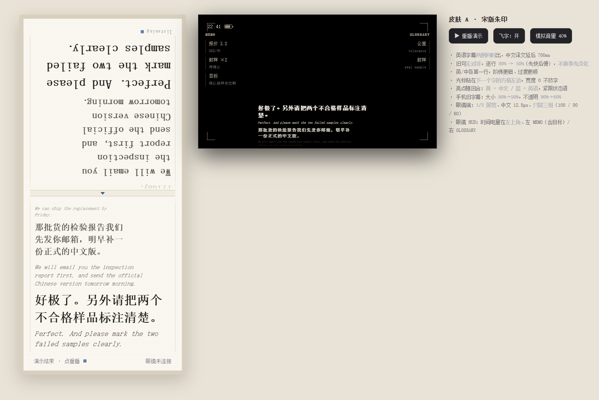 
<b>A · 宋版 · 朱印</b>　纸本双色，界行与鱼尾照宋刻本，朱印只给「正在说」</td>
<td width="50%">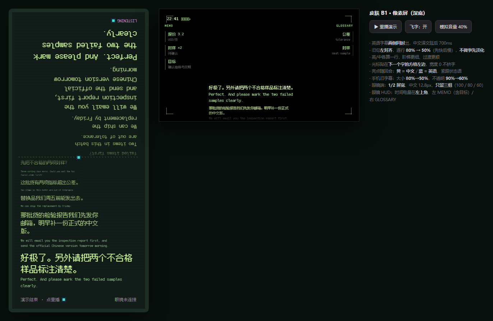 
<b>B1 · 像素屏 · 深底</b>　12 px 点阵字体，分界线用 3×3 实心点而不是线</td>
</tr>
<tr>
<td>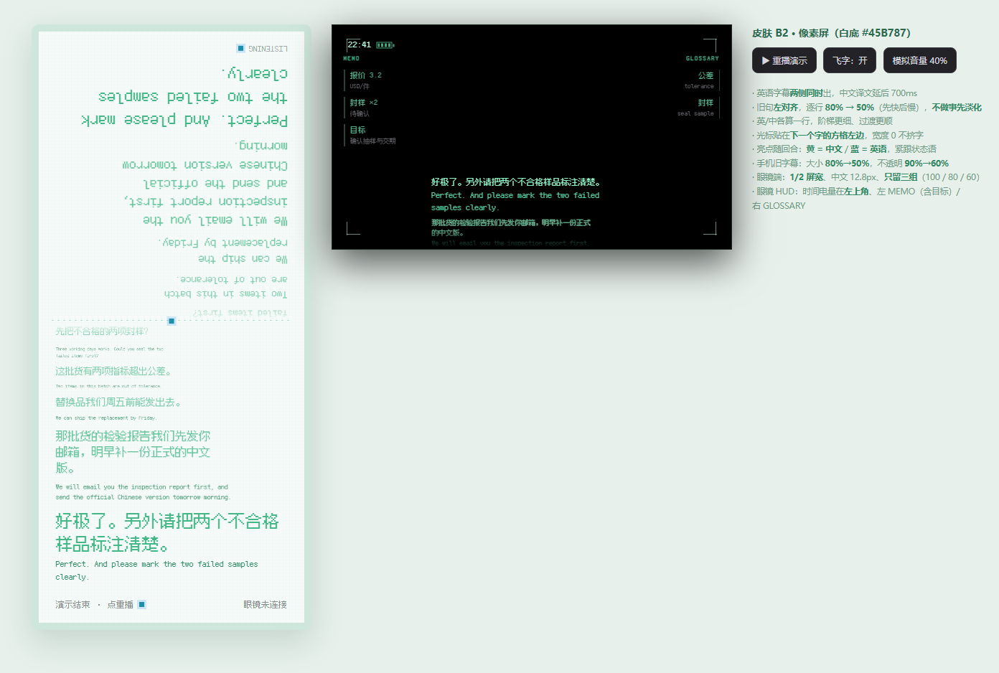 
<b>B2 · 像素屏 · 白底</b>　同一套点阵搬到纸上，绿点划线接缝</td>
<td>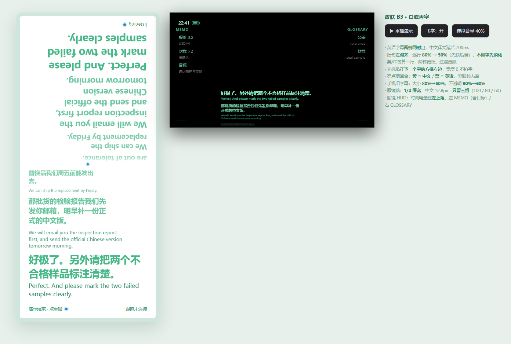 
<b>B3 · 白底青字</b>　抽掉点阵换常规字族，证明「像素感」是可拆的一层</td>
</tr>
<tr>
<td>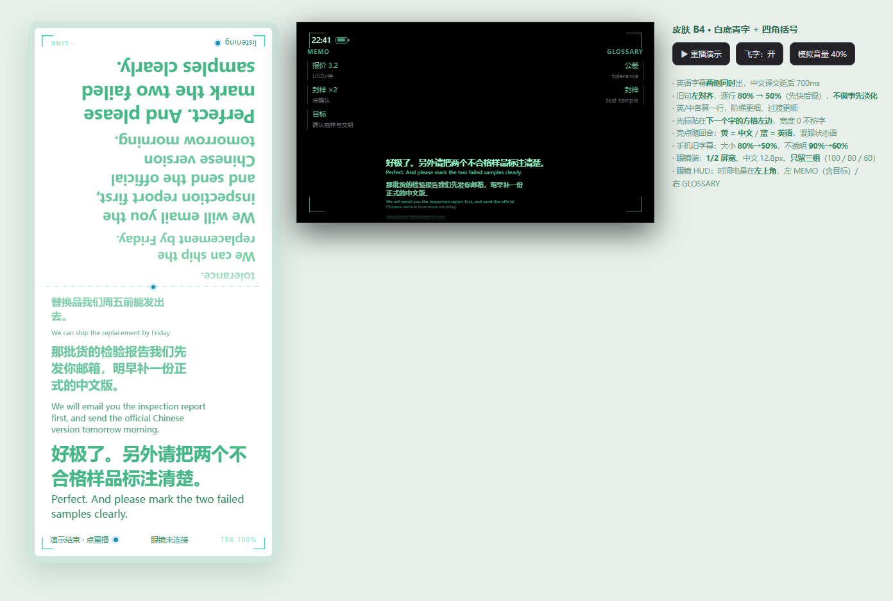 
<b>B4 · B3 + 四角括号</b>　加四角 HUD 框与 LINK / TRK 读数，多一层设备感</td>
<td> 
<b>B5 · B3 + 飞字</b>　字符从对面那侧起飞、边飞边转 180°，落到目标行</td>
</tr>
<tr>
<td>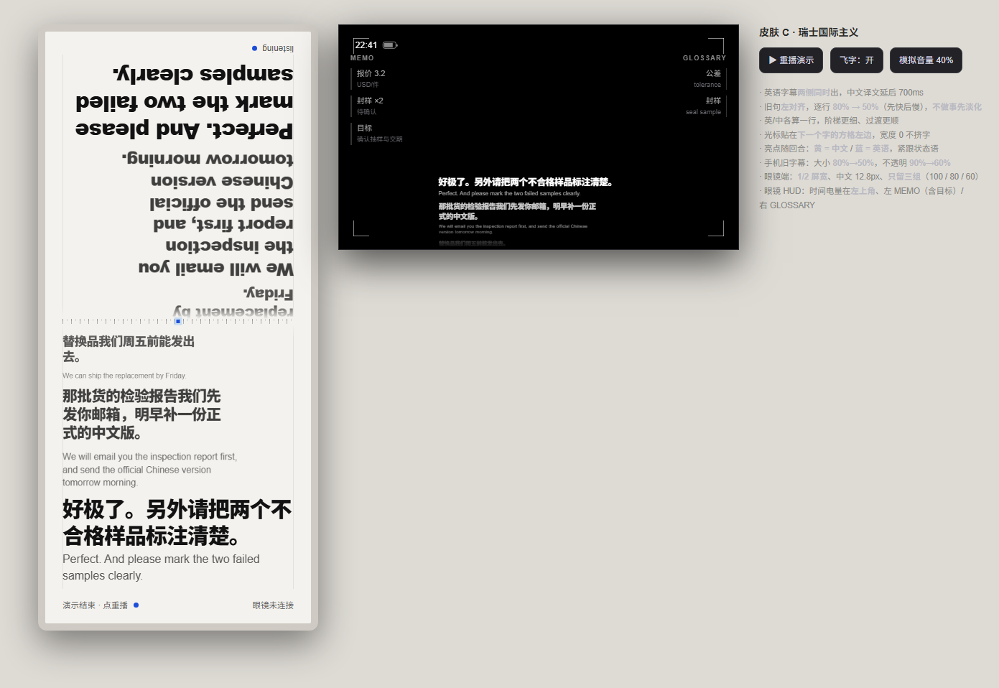 
<b>C · 瑞士国际主义</b>　严格栅格、字阶 1.25 以上，分界线是刻度短桩</td>
<td>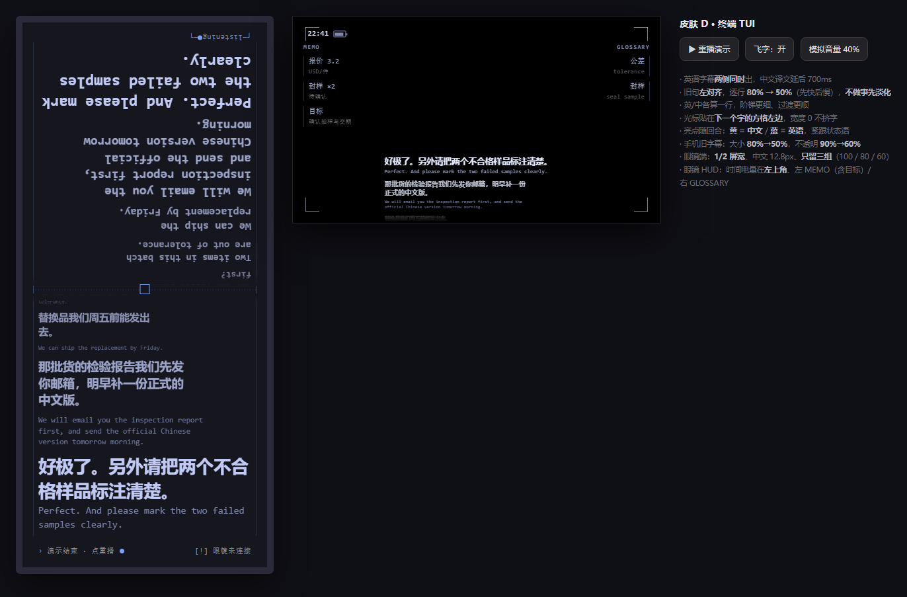 
<b>D · 终端 · TUI</b>　全暗色等宽，1 px 虚线加两端竖线，像 tmux 分屏</td>
</tr>
<tr>
<td>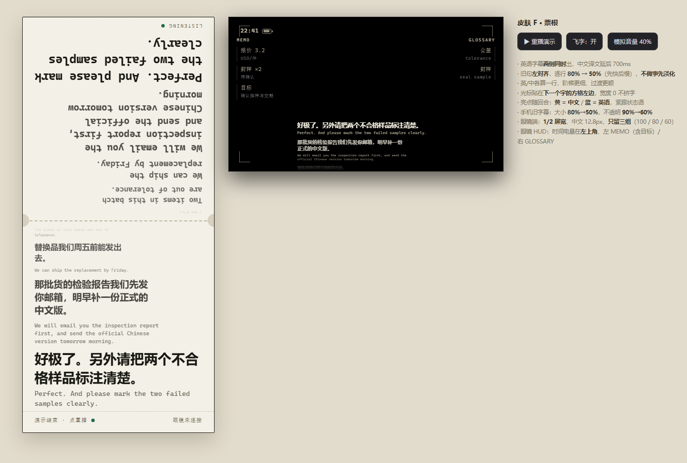 
<b>F · 票根</b>　撕票线 + 两侧半圆打孔，打孔处真的透出桌面色</td>
<td>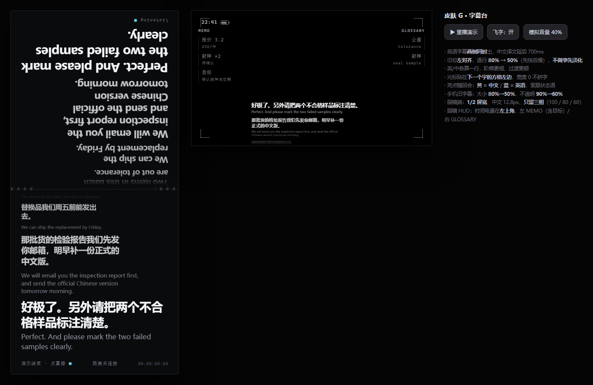 
<b>G · 字幕台</b>　胶片齿孔边框，历史句被画框边缘切掉一半</td>
</tr>
<tr>
<td>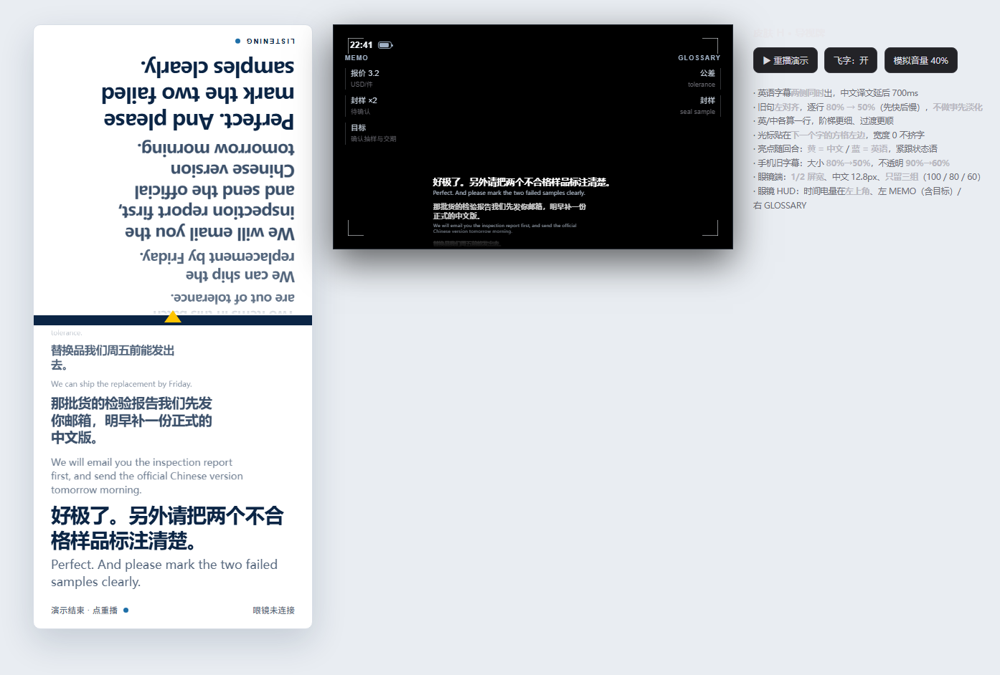 
<b>H · 导视牌</b>　本方案约定黄色只用于指向对方，不进正文</td>
<td>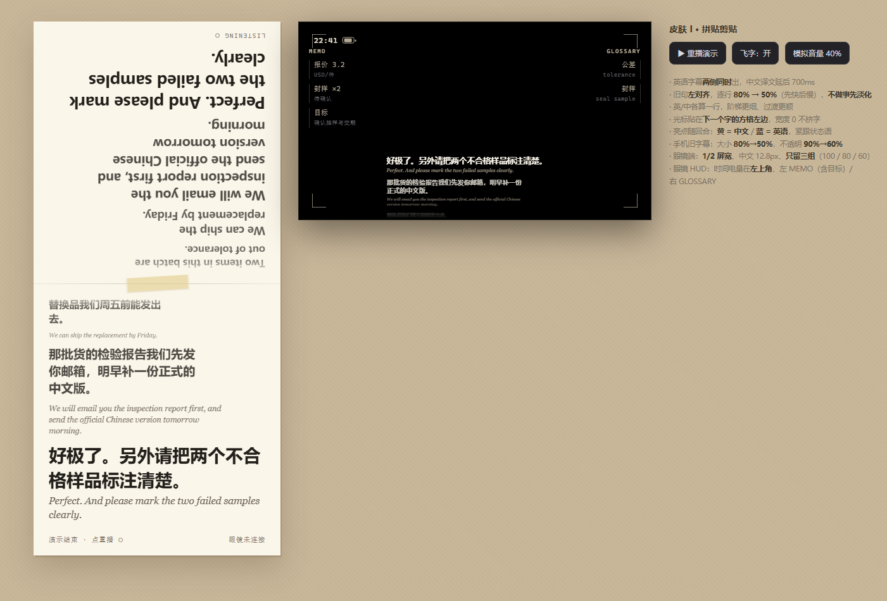 
<b>I · 拼贴剪贴</b>　牛皮纸桌面 + 白纸面板，纸缝与斜贴胶带</td>
</tr>
<tr>
<td>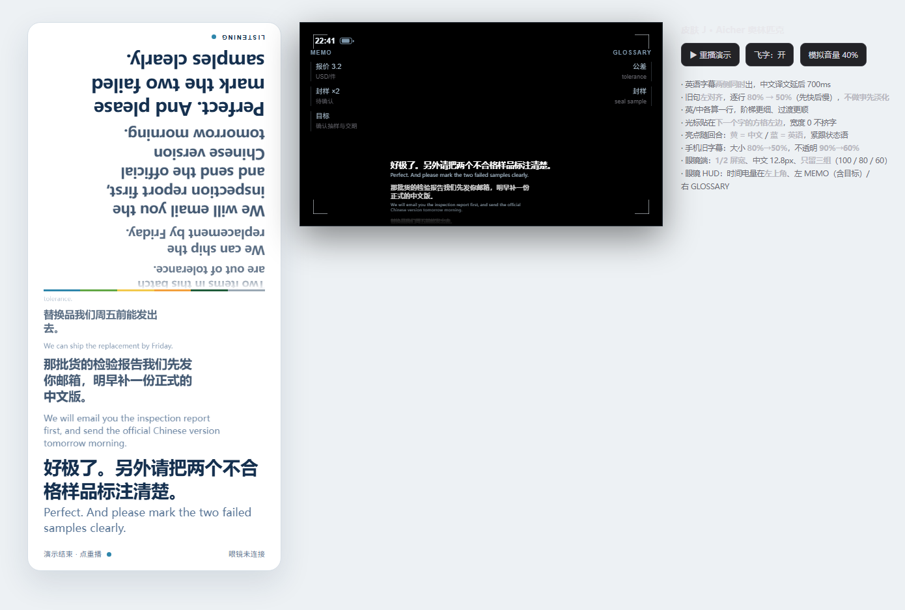 
<b>J · Aicher 奥林匹克</b>　六色段细带，参考 Aicher 的配色逻辑，刻意不用红与金</td>
<td>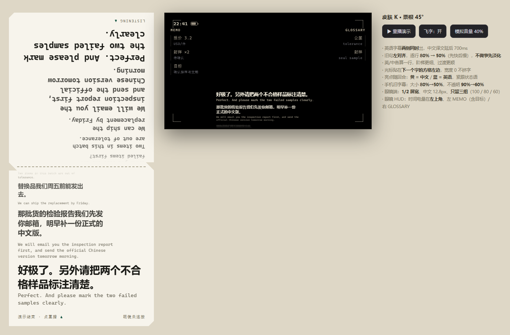 
<b>K · 票根 · 45°</b>　三角切口只允许 45° 与 90°，是本方案的自我约束</td>
</tr>
</table>

## 被淘汰的一套

皮肤编号里没有 E。第一批的 E（构成主义 · 斜轴）被放弃：斜轴 −5° 会划过对方那栏最后一行字，且红块压住深色正文不可读（按 WCAG 公式算约 2.1:1）。判定过程写在 `../_skipped/README.md`，成品不入库。
